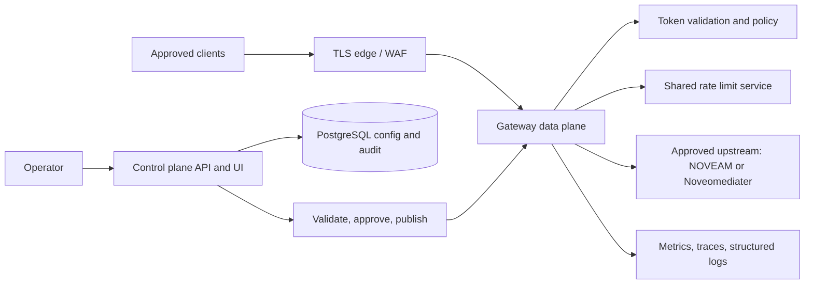

# Noviokro production gateway: plan and specification

Status: **proposal**, 2026-11-15. Owner and upstream teams must approve the open decisions below before implementation. This document specifies the production replacement for the current staging gateway; it does not certify the repository as production ready.

## 1. Goal and boundaries

Provide a reliable, authenticated HTTP gateway for explicitly approved NOVEAM and Noveomediater APIs. Operators can register an upstream and route, review and publish a versioned policy, observe traffic, and roll back. Clients can invoke only routes allowed for their identity and project. The gateway must not turn API catalog discovery into permission to call an endpoint.

The first production slice is one **read-only NOVEAM categories route**. Registration, login, other write routes, Noveomediater, bots, AI inference, and natural-language commands require separate route contracts and release gates. The initial gateway supports ordinary HTTP/JSON requests and responses up to configured limits. Streaming, WebSockets, file uploads, and arbitrary URL forwarding are out of scope until separately specified and tested.

### Current baseline and gaps

| Current code | Consequence for production work |
| --- | --- |
| `backend/app/main.py` has an in-memory route registry and a proxy guarded by one admin key. | It cannot serve as the public data plane or a durable policy source. |
| `backend/app/v12.py` has an opt-in staging proxy, IP-literal restriction, and per-process minute counter. `v14.py` adds optional database limits and telemetry only for that staging path. | Replace with one defined production forwarding path, shared limits, and complete observability. Do not widen these endpoints into production traffic. |
| `backend/app/integrations.py` discovers configured API catalogs. Its categories endpoint calls `https://noveam-backend.onrender.com` directly. | Discovery remains read-only metadata. Move the categories destination into an approved upstream registry; remove the hard-coded live address before deployment. |
| `backend/app/extensions.py` and several later modules initialize tables at runtime or on first use; database URLs and authentication checks differ by version. | Use one production configuration system, reviewed migrations, and one authorization layer. |
| `docker-compose.yml` binds local services and includes a development password. `v20.py` reports `production_ready: false`. | Compose remains for local development. A separate production deployment, secrets, backup, and operational verification are required. |

The root `config/routes.json` is a disabled staging sketch, not a live routing policy. The current README history describes local development and isolated staging, not an established production integration.

## 2. Target architecture

**Separate data and control planes.** Deploy a dedicated, well-supported HTTP proxy data plane (proposed: Envoy) behind a managed TLS edge. Use Noviokro/FastAPI as the private control plane for route lifecycle, authorization policy management, and audit. The public data plane must not import legacy bot, dashboard, discovery, or development routes. A signed or otherwise authenticated, versioned policy snapshot is published to the data plane; it keeps the last known good version if the control plane is unavailable. Select and prototype the proxy configuration mechanism before committing to Envoy. No request may fall back to the old `/gateway` or `/api/v1/v12/proxy` handlers.

The control plane stores durable configuration in PostgreSQL. The gateway uses a shared, bounded rate limit store/service so all replicas enforce one policy. Use a supported identity provider for operator login and client tokens. Export telemetry to the organization's observability stack. Run the proxy, control plane, database, and rate limit service in separate security domains with least-privilege network access.

### Route policy object

Each published route has: immutable `route_id`; project and owner; external method and path template; upstream ID and internal path mapping; allowed client scopes/roles; optional object-level authorization hook; upstream credential mode; request/response size and time limits; rate/concurrency quotas; CORS policy where needed; enabled state; policy version; change ticket and approvers. Store a unique normalized `(method, external path)` key. Deny ambiguous or overlapping paths at publication time. Catalog entries are candidates only; an operator must explicitly create and approve each route.

Control plane lifecycle: `draft -> validated -> approved -> published -> retired`. Production publication requires a second authorized approver, an audit record, and an atomic policy version change. A rollback republishes the previous approved snapshot. A route starts disabled. Emergency disable must propagate within a measured maximum of 30 seconds; if this cannot be guaranteed by the chosen control channel, the edge must provide an independent kill switch.

## 3. Request contract

1. Terminate public TLS at the edge; re-encrypt to the data plane and upstream. Trust forwarded client metadata only from the edge's authenticated network path. Reject direct public access to internal services.
2. Normalize and validate method, host, path, query encoding, and headers once before route selection. Reject ambiguous encodings, traversal, malformed framing, duplicate security headers, invalid content length, and unsupported methods. Match only published route templates; never accept a client-supplied upstream URL.
3. Authenticate the caller. Validate token signature through pinned issuer configuration, algorithm allowlist, audience, expiry, and key rotation. Authorize project, route, method, scope, and object ownership where applicable. Browser operator access uses OIDC authorization code with PKCE and a secure server-side session. Service clients use a scoped machine identity; mTLS or sender-constrained tokens should be chosen where the client environment supports them. The old `X-Admin-Key` is not accepted on the public data plane.
4. Apply a shared quota by client/project/route and an upstream concurrency cap. Return `429` with `Retry-After` for quota failures; reject or shed load when resource limits are reached. Define each route's maximum body, response, header, and query size. Do not buffer unbounded payloads.
5. Resolve only an operator-approved destination. Use HTTPS, verify hostname and certificate, restrict egress to approved upstreams, reject redirects by default, and protect against DNS rebinding and private-network/metadata targets. Private upstreams require an explicit private network integration with equivalent egress controls, not a public-URL exception. Separate upstream credentials by project and route, fetch from a secret manager, and never forward the caller's bearer token, cookies, or gateway credentials unless the route contract explicitly requires and tests a token exchange.
6. Forward only approved headers; strip hop-by-hop headers, untrusted forwarding headers, and secrets. Preserve trace context according to policy. Set bounded connect, read, write, and total deadlines. Retry only idempotent operations where the route contract explicitly permits it, with a small retry budget and backoff. Do not retry registration/login or other writes by default. Preserve safe upstream status codes and content types; map connection failures to stable gateway errors without leaking hosts or credentials.
7. Emit a request ID and telemetry with route ID, project, caller class, outcome, latency, and upstream status. Do not log bodies, tokens, cookies, raw query strings, or personal data. Apply retention and access rules to audit and operational logs.

### Initial route: NOVEAM professional categories

Public contract proposal: `GET /api/noveam/v1/professional/categories` -> NOVEAM `GET /api/professional/categories`. The exact public path, schema, audience, and cacheability require NOVEAM owner approval. The upstream comes from the registry, not the hard-coded Render URL. Require a scoped client identity even if the upstream endpoint is publicly readable, until its data classification is confirmed. No write, login, registration, or discovered route is enabled by this slice. Contract tests must confirm status, content type, payload bounds, schema tolerance, cache behavior, error mapping, and that no gateway credential reaches NOVEAM.

## 4. Control plane and operations

- **Identity and access:** operator roles for viewer, route editor, approver, and emergency operator; project-scoped access; separate human and machine identities; audit every create, approval, publish, rollback, secret reference change, and emergency disable. Apply object-level checks to every route and project record. Keep the UI private.
- **Configuration:** one schema and migration history for upstreams, routes, policy versions, approvals, and audit. Use expand/contract migrations, explicit startup readiness checks, and no `create_all` in production. Back up PostgreSQL, encrypt it, and rehearse point-in-time restore. Ensure replicas load the same published version and expose that version in health/telemetry.
- **Secrets and supply chain:** secret manager and rotation; no production values in `.env`, Compose, images, or CI logs. Pin and scan images and dependencies, generate an SBOM, sign release artifacts where the deployment platform supports it, and use non-root, read-only containers with minimal privileges.
- **Observability:** separate liveness from readiness. Readiness checks policy load and critical dependencies without requiring upstream availability. Track request rate, 4xx/5xx, upstream failure, p50/p95/p99 latency, saturation, rate-limit denials, policy version, and audit delivery. Use distributed traces and low-cardinality route IDs. Alert on SLO burn, abnormal denies, failed publishes, stale policy, and upstream errors. Provide runbooks for rollback, disabling a route, token compromise, upstream outage, data restore, and incident response.
- **Availability:** deploy at least two data-plane replicas across failure domains; rolling or canary updates; protect upstreams with circuit breaking and connection limits. Control plane or database outage must not stop existing approved traffic while the current policy remains valid. An expired or untrusted policy must fail closed according to a documented maximum stale-policy period.

## 5. Verification and release gates

The following are **proposed initial service targets**, to confirm with the platform and NOVEAM owners before the performance gate: 99.9% monthly gateway availability for approved routes, p95 added gateway latency at most 50 ms at the agreed representative load, and a 30-second emergency-disable objective. Measure gateway overhead separately from upstream latency. Define the load profile, regions, payload sizes, and dependency failure model in the test report; do not claim these targets from unit tests alone.

| Gate | Evidence required |
| --- | --- |
| Contract | NOVEAM owner signs off route, payload classification, auth model, upstream SLO, error mapping, and allowed environments. Noveomediater gets a separate contract. |
| Security | Threat model and tests for broken object/function authorization, SSRF/DNS rebinding, path ambiguity, header injection, token replay, quota bypass, secret leakage, and unsafe upstream responses. Independent security review resolves all critical/high findings or records an explicit risk acceptance by the accountable owner. |
| Functional | Integration tests against isolated upstreams for routing, auth, quotas across replicas, timeout, retry, circuit break, error mapping, config publish/rollback, and emergency disable. Browser tests cover control-plane RBAC and approval. |
| Reliability | Load and soak tests at the agreed profile; dependency-failure drills for IdP, control plane, PostgreSQL, rate limit store, DNS, and upstream; backup restore and regional/failure-domain recovery drills. Results meet agreed SLO and recovery objectives. |
| Delivery | CI passes static checks, tests, migration checks, dependency/image scans, SBOM generation, and reproducible build. Staging and production use the same artifact; production uses separate credentials and networks. |
| Operations | Dashboards, alerts, ownership, on-call, runbooks, audit retention, data retention, rollback procedure, and incident contact list are reviewed. A canary is observed and rollback is demonstrated before broad traffic. |

No readiness endpoint may report `production_ready: true` solely from static flags or CI job names. It should report independently recorded gate evidence and the deployed artifact/policy version.

## 6. Delivery sequence

1. **Contract and threat model.** Confirm owners, data classification, public route shape, identity provider, upstream auth, capacity targets, regions, recovery targets, and audit retention. Write a route contract and an abuse-case matrix. Gate: approved design and first route contract.
2. **Contain legacy surfaces.** Keep the existing app private; remove or disable the hard-coded live NOVEAM call in production builds; ensure the old in-memory and staging proxies are unreachable from the public edge. Gate: network and deployment tests prove no public legacy path.
3. **Build control plane.** Add migrations, upstream/route/policy tables, centralized RBAC, approval workflow, immutable audit, validation, snapshot publishing, and rollback. Gate: cross-project access and two-person approval tests pass.
4. **Build data plane.** Implement published route matching, auth, egress restrictions, header/URL normalization, quotas, timeouts, bounded payloads, telemetry, and error mapping. Gate: security and failure-mode integration tests pass across replicas.
5. **NOVEAM canary.** Enable only professional categories in isolated staging, then a low-traffic production canary with NOVEAM's approval. Compare direct and gateway responses, observe SLOs, and exercise rollback. Gate: signed canary report and on-call handoff.
6. **Expand route by route.** Add NOVEAM writes/auth and Noveomediater only after separate contracts and tests. Retire redundant versioned staging routes from the production deployment after clients migrate. Bots and AI remain outside the gateway request path unless separately designed and reviewed.

## 7. Decisions to resolve before implementation

| Decision | Proposed default |
| --- | --- |
| Public host and path scheme | Dedicated gateway hostname, versioned project path, no transparent takeover of current NOVEAM URLs. |
| Identity provider and client token format | Organization OIDC provider; audience-restricted access tokens; service-to-service identity for non-browser clients. |
| NOVEAM upstream auth and data classification | Keep route disabled until NOVEAM owner provides a contract. Never reuse the Noviokro admin key upstream. |
| Proxy and policy distribution | Prototype Envoy with authenticated, versioned config snapshots; document operational ownership before selection. |
| Rate limit dependency failure | Fail closed for protected routes, with a small documented local emergency capacity only if security review approves it. |
| Availability, latency, RTO/RPO, retention | Confirm numeric targets with product, platform, and security owners; record them in the route/service contract. |

## 8. Reference standards

The security gates map to the [OWASP API Security Top 10 (2023)](https://api-security.owasp.org/editions/2023/en/0x11-t10/), especially authorization, resource consumption, SSRF, and unsafe upstream consumption. OAuth/OIDC design should follow [RFC 9700, OAuth 2.0 Security Best Current Practice](https://www.rfc-editor.org/rfc/rfc9700.html). Egress design should follow the [OWASP SSRF Prevention Cheat Sheet](https://cheatsheetseries.owasp.org/cheatsheets/Server_Side_Request_Forgery_Prevention_Cheat_Sheet.html). HTTP telemetry should use [OpenTelemetry HTTP semantic conventions](https://opentelemetry.io/docs/specs/semconv/http/http-metrics/).
